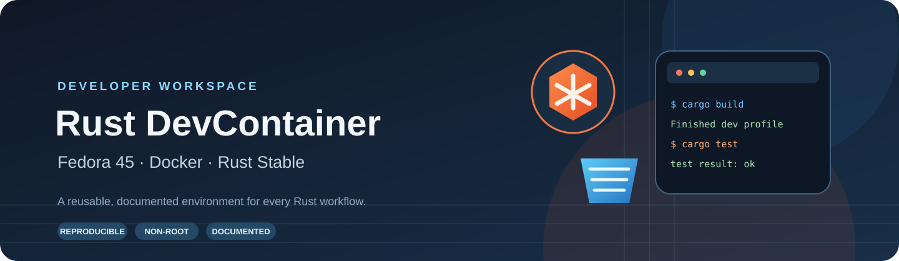

# Rust DevContainer · Fedora 45

A reusable, Docker-based Rust development environment built on Fedora Linux 45. It is designed as an independent starter/template repository and can be copied into, or adapted for, different Rust projects.



[Architecture](assets/architecture.svg) · [Workflow](assets/workflow.svg) · [Technology stack](assets/technology-stack.svg)

## What is included

- Fedora 45 base image with common native build dependencies.
- Rust stable via `rustup`, with `rustfmt`, `clippy`, `rust-analyzer`, and WebAssembly target.
- Docker Compose-based development container and non-root `vscode` user.
- VS Code Dev Containers integration and Rust-focused extensions.
- Zsh and Starship prompt.
- Cargo utilities: `cargo-nextest`, `cargo-audit`, and `cargo-deny`.
- Optional profiles for backend, WASM, desktop, and embedded development.
- Environment verification and script documentation.

> **Scope note:** “All Rust project types” does not mean every platform SDK is installed in the base image. Embedded toolchains, Android SDKs, Apple toolchains, GPU stacks, and some desktop libraries are platform- and project-specific. Install those only when needed using the relevant profile and project documentation.

## Requirements

- Docker Engine or Docker Desktop with Docker Compose v2.
- Visual Studio Code.
- Microsoft **Dev Containers** extension.
- Git.
- A host operating system supported by Docker.

Fedora 45 is the container operating system; your host OS does not need to be Fedora.

## Quick start

1. Clone or copy this template.
2. Open the folder in VS Code.
3. Run **Dev Containers: Reopen in Container** from the Command Palette.
4. Wait for the image build and first-time Rust setup.
5. Open a terminal and verify the environment:

```bash
bash .devcontainer/scripts/verify-environment.sh
rustc --version
cargo --version
```

To validate the Compose configuration before opening VS Code:

```bash
docker compose -f .devcontainer/docker-compose.yml config
```

## Use it with an existing Rust project

Copy the `.devcontainer/` directory into the root of your project. Also copy `assets/` and `docs/` if you want the complete documentation package. Open the project root in VS Code and choose **Reopen in Container**.

The container mounts the repository root at `/workspace`. It does not generate, overwrite, or restructure your Rust source files.

## Common commands

```bash
# Create a new Rust binary project in the workspace
cargo new hello-rust
cd hello-rust
cargo run

# Format, lint, and test
cargo fmt --all -- --check
cargo clippy --all-targets --all-features -- -D warnings
cargo test --all

# Run tests with nextest
cargo nextest run

# Security/advisory and dependency policy checks
cargo audit
cargo deny check

# Verify installed environment tools
bash .devcontainer/scripts/verify-environment.sh
```

## Optional tool profiles

Run from the repository root inside the container:

```bash
bash .devcontainer/scripts/install-rust-tools.sh core
bash .devcontainer/scripts/install-rust-tools.sh backend
bash .devcontainer/scripts/install-rust-tools.sh wasm
bash .devcontainer/scripts/install-rust-tools.sh desktop
bash .devcontainer/scripts/install-rust-tools.sh embedded
```

| Profile | Adds |
|---|---|
| `core` | cargo-watch, nextest, audit, deny |
| `backend` | Core utilities and SQLx CLI |
| `wasm` | wasm target, wasm-pack, trunk |
| `desktop` | Desktop workflow guidance; native GUI libraries remain project-specific |
| `embedded` | LLVM tools, cargo-binutils, probe-rs tools |
| `all` | Runs every profile (large; not recommended unless needed) |

## Scripts at a glance

| Script | When it runs | Responsibility |
|---|---|---|
| `initialize.sh` | Container creation hook | Checks workspace and script permissions |
| `post-create.sh` | After container creation | Installs Rust components and baseline Cargo tools |
| `post-start.sh` | Each container start | Performs lightweight readiness checks |
| `install-rust-tools.sh` | Manually, when needed | Installs optional tool profiles |
| `verify-environment.sh` | Manually or CI | Reports missing and available tools |

Detailed explanations, execution order, safety behavior, and troubleshooting are in [Script Reference](docs/SCRIPT-REFERENCE.md).

## Documentation

- [Architecture](docs/ARCHITECTURE.md)
- [Installation and first run](docs/INSTALLATION.md)
- [Configuration reference](docs/CONFIGURATION.md)
- [Rust development workflows](docs/RUST-DEVELOPMENT.md)
- [Script reference](docs/SCRIPT-REFERENCE.md)
- [Security model](docs/SECURITY.md)
- [Troubleshooting](docs/TROUBLESHOOTING.md)

## Design principles

1. **Reproducible:** use a declared Fedora major release and a checked-in Rust toolchain file.
2. **Non-root by default:** daily development runs as `vscode`.
3. **Small default footprint:** optional SDKs are installed by profile.
4. **Transparent automation:** lifecycle scripts are documented and safe to re-run where practical.
5. **Portable project integration:** the template does not assume a particular application architecture.

## Important notes

- The Rust channel is `stable`; the exact patch release advances as the stable channel updates.
- For stricter reproducibility, pin the Rust toolchain to a specific version in `config/rust-toolchain.toml`.
- Docker socket access is intentionally not mounted into the container by default.
- The SSH directory mount is read-only in intent only if your host/daemon configuration enforces it; review your local permissions before using sensitive keys.
- Review all security and platform-specific guidance before using this environment for production builds.

## License

MIT. See [LICENSE](LICENSE).
