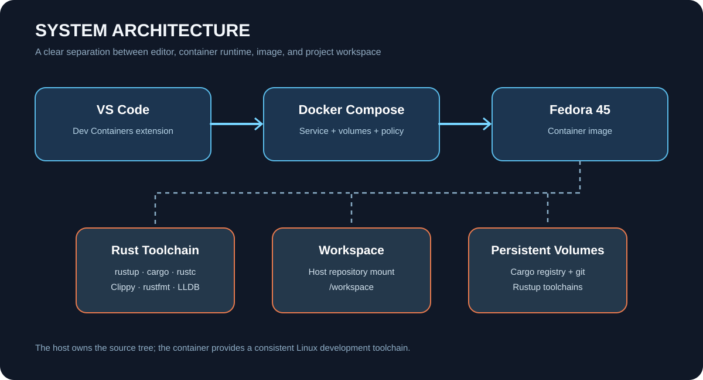

# Architecture

## Overview

This repository is a reusable Dev Container template. VS Code reads `.devcontainer/devcontainer.json`, delegates container lifecycle to Docker Compose, and mounts the opened repository at `/workspace`.

## Main components

| Component | Purpose |
|---|---|
| `devcontainer.json` | VS Code Dev Containers configuration, extensions, ports, and lifecycle hooks |
| `Dockerfile` | Builds the Fedora 45 image and installs OS-level developer dependencies |
| `docker-compose.yml` | Runs the development service and persists Cargo/Rustup caches |
| `config/` | Rust toolchain and shell configuration |
| `scripts/` | Lifecycle automation, optional tool installation, and verification |
| `assets/` | SVG diagrams used by documentation |

## Lifecycle sequence

1. `initializeCommand` runs on the host to validate Compose configuration.
2. Docker builds the image if necessary.
3. `onCreateCommand` runs `initialize.sh` inside the container.
4. `postCreateCommand` runs `post-create.sh` once after container creation.
5. `postStartCommand` runs `post-start.sh` whenever the container starts.

The scripts intentionally separate image construction, one-time container setup, repeat-start checks, and optional user-requested installations.

## Storage

- Repository source: bind-mounted from host to `/workspace`.
- Cargo registry and Git checkouts: named Docker volumes.
- Rustup toolchains: named Docker volume.

Named volumes preserve downloads between container rebuilds. Removing these volumes will force downloads again.

## Design boundaries

This template provides a broad Linux Rust toolchain. It does not attempt to bundle every SDK for every hardware platform or host-specific ecosystem. See [Rust development](RUST-DEVELOPMENT.md).
